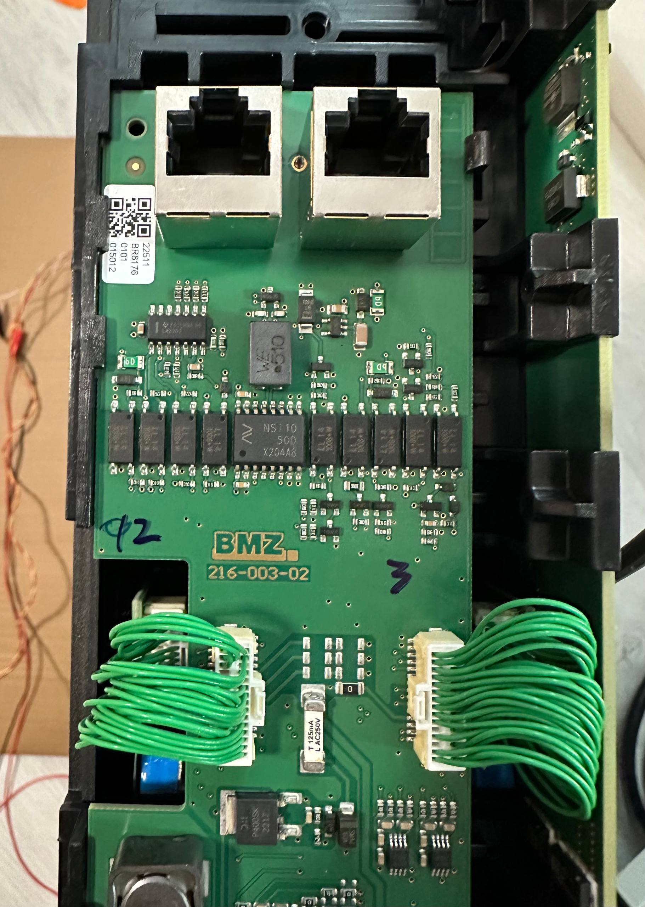
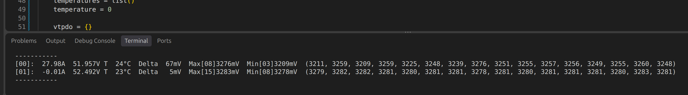

## Reverse engineering BMZ 2500Wh BMS

RJ45 pinout:
1. CAN H
2. CAN L
3.
4. Vcc (+12V CAN driver power supply)
5.
6.
7. GND
8.

CAN Bus driver:

Configure CAN:  
`sudo ip link set can0 type can bitrate 500000` git 

Link UP:  
`sudo ip link set can0 up`  

Run:  
`./bat.py -i can0`  

Output:  
`[00]:   0.00A  52.418V T  25°C  Delta   8mV  Max[15]3279mV  Min[01]3271mV  (3271, 3278, 3271, 3277, 3273, 3276, 3275, 3278, 3278, 3277, 3278, 3277, 3277, 3277, 3279, 3276)`  
`[01]:  -0.01A  52.478V T  24°C  Delta   4mV  Max[02]3281mV  Min[01]3277mV  (3277, 3281, 3281, 3280, 3279, 3281, 3281, 3278, 3280, 3280, 3280, 3281, 3280, 3279, 3281, 3279)`  
-----------`  

